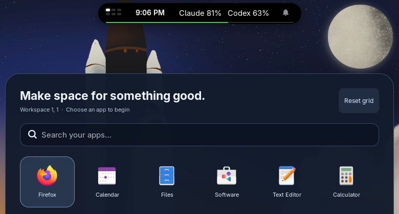
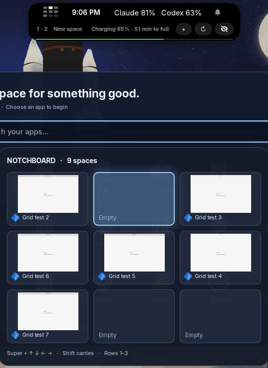
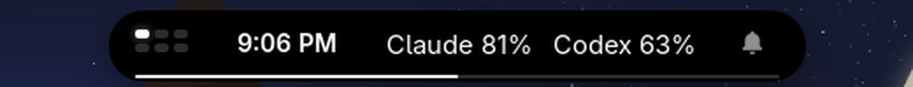
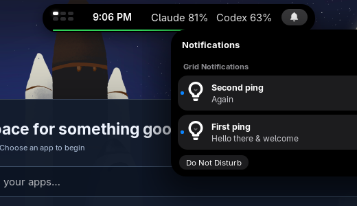
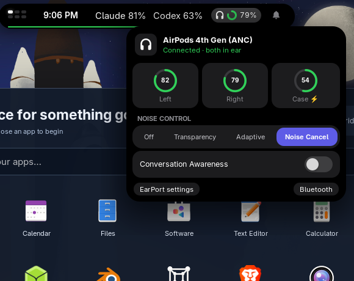

<div align="center">



<br>

**Every app on its own screen in a 2D grid, with a Dynamic Island in place of the top bar.**

[](https://github.com/KanterLabs/notchboard/actions/workflows/ci.yml)


[Quick start](#quick-start) ·
[Features](#features) ·
[Shortcuts](#shortcuts) ·
[Settings](#settings) ·
[How it works](#how-it-works) ·
[Development](#development)

</div>

---

Notchboard is a GNOME Shell extension that turns workspaces into a board.
Each normal window gets its own workspace in a three-column grid, and
`Super` + arrows slides between them. The full-width top bar is replaced by
a floating black **notch**, styled like iPhone's Dynamic Island. It holds a
live mini-map of the grid, the clock, your notifications, AirPods and the
laptop battery.

<a id="quick-start"></a>

## 🚀 Quick start

Requires GNOME Shell 49 on Wayland.

```sh
git clone https://github.com/KanterLabs/notchboard.git
cd notchboard
make install
```

Log out and back in once so GNOME Shell discovers the extension. After that,
`make install` updates a running copy in place, with no logout.

To turn it off, use the Extensions app or
`gnome-extensions disable notchboard@kanterlabs.dev`. Disabling puts every
window, setting, shortcut, dock and the top bar back the way they were.

<a id="features"></a>

## ✨ Features

### The board

- **One app per screen.** New windows open maximized in the nearest empty
  cell. Positions stay put when other windows close, and rows grow as needed
  (up to GNOME's 36 workspaces).
- **Spatial navigation.** `Super` + arrows slides to the neighbouring cell;
  add `Shift` to carry the focused window with you. Edges and occupied cells
  give a small nudge instead of wrapping.
- **Live map.** Tap `Super` for a map of every cell with live thumbnails;
  click one to jump there.
- **Launcher on empty screens.** An empty cell shows your favourite and
  most-used apps with search, so a new screen is always one keystroke from
  something useful.



### The notch



- **Grid at a glance.** Dots show which cells are occupied and where you are.
  Hover for a drawer with your position, `+` (new space), `↻` (pack the grid)
  and hide.
- **Notifications without pop-ups.** Banners go to a bell instead. It wiggles
  and counts what you missed, and a click shows the list. Critical alerts,
  such as low battery, still pop up.
- **AirPods.** With [EarPort](https://github.com/Anoryth/earport) installed,
  the notch shows AirPods battery and noise control. A card appears when they
  connect. When AirPods don't report battery over EarPort's link, Notchboard
  reads their Bluetooth LE broadcast instead (10% steps).
- **Battery line.** A hairline along the bottom shows laptop charge: white,
  green on power, red when low.
- **One panel indicator of your choice** can live in the notch (by default the
  AI Usage indicator, if installed).
- **Hide it** with `Super` + `Shift` + `H`; touch the top edge to peek.

<p>


</p>

<a id="shortcuts"></a>

## ⌨️ Shortcuts

| Shortcut | Action |
| --- | --- |
| `Super` | Toggle the grid map |
| `Super` + arrows | Move to the neighbouring cell |
| `Super` + `Shift` + arrows | Carry the focused window to an empty neighbour |
| `Super` + `Shift` + `Backspace` | Pack windows together and remove unused rows |
| `Super` + `Shift` + `R` | Close this cell's windows and show its launcher |
| `Super` + `Shift` + `H` | Hide or show the notch |

Every shortcut is a setting and can be rebound.

<a id="settings"></a>

## ⚙️ Settings

```sh
schemas=~/.local/share/gnome-shell/extensions/notchboard@kanterlabs.dev/schemas
gsettings --schemadir $schemas list-recursively org.gnome.shell.extensions.notchboard
```

| Key | Default | Meaning |
| --- | --- | --- |
| `animation-ms` | `140` | Slide duration; GNOME's reduced-motion setting is respected |
| `notch-hidden` | `false` | Hide the notch until the pointer touches the top edge |
| `hosted-indicator` | `'ai-usage@laptopconfig'` | Panel indicator shown in the notch, by status-area key; empty for none |
| `grid-*` | see [Shortcuts](#shortcuts) | Keybindings |

<a id="how-it-works"></a>

## 🔧 How it works

- **Live updates.** `extension.js` is a small loader that GNOME caches for
  the session. Each update is staged as an immutable, content-addressed release
  and swapped in over a session D-Bus call, keeping every window in its
  cell. A release that fails to import or start is rolled back automatically.
- **Leaves no trace.** Every GNOME setting Notchboard changes, such as fixed
  workspaces or the Super key, is journaled first and restored on disable.
  The journal survives a Shell crash, and `make restore` replays it if the
  extension can't load. Docks and the top bar are only hidden, never
  reconfigured.
- **Plays well with others.** It claims only the Super-arrow bindings, from
  GNOME and Tiling Assistant, and leaves their other shortcuts alone.

More detail is in [docs/USAGE.md](docs/USAGE.md).

<a id="development"></a>

## 🧪 Development

```sh
make test         # grid logic and settings schema
make test-shell   # the integration suite in a real headless gnome-shell
make status       # which release is running
```

The integration suite starts an isolated headless GNOME Shell with its own
D-Bus session, settings and data. It drives real GTK windows, keyboard and
pointer input, notifications, a fake EarPort service and hot reloads, and
saves screenshots. Set `NOTCHBOARD_TEST_TILING=1` or `NOTCHBOARD_TEST_DOCK=1`
to also run your installed Tiling Assistant or Dash to Dock alongside it.

## License

[MIT](LICENSE) © KanterLabs
